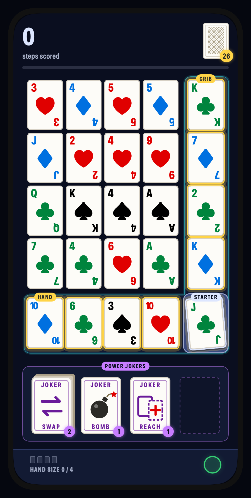
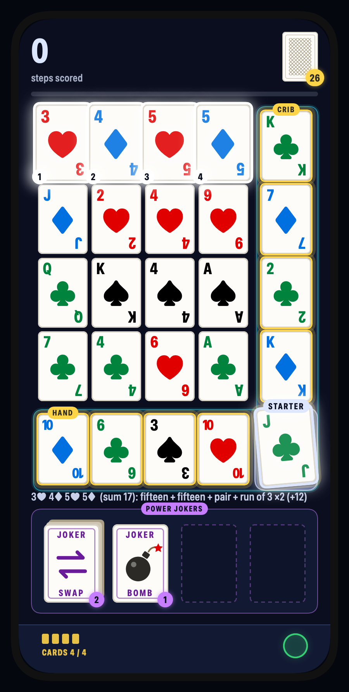
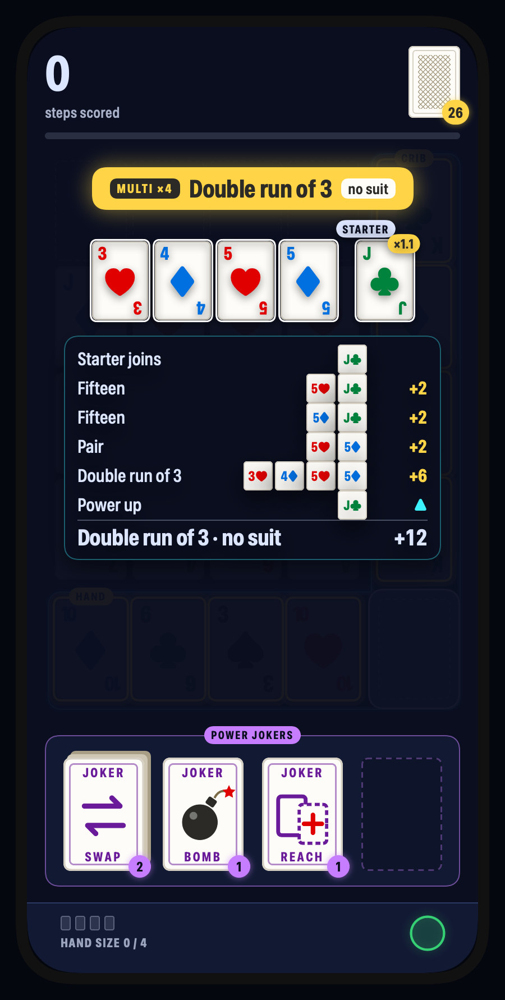

# Noddy Yookerspiel (Cribbage Jokers)

Cribbage with jokers, made into a video game: 1 player against 1 or 2 bots, on one standard 52-card deck plus a few jokers. You still discard to the crib, peg to 31 and count fifteens, but each round has two kinds of play, a scoring grid and pegging, and the points you make move you along a board that forks and holds prizes. The design docs use its working title, Crib Maze.

This repo, Warped Cards, holds the free card game demos and the specs, simulations and tests behind them.

## How a round plays

Each round starts as classic cribbage: the deal, the discard to the crib, and the cut for the starter. Then come the two kinds of play.

**The scoring grid** replaces counting your hand. Your hand lines the bottom of a 4 × 4 grid of cards, the crib runs down the side when you deal, and the starter sits in the corner.

- Drag across 2 to 4 touching cards, diagonals included. The set scores at once, counted like a cribbage hand: fifteens, pairs, runs, flushes and his nobs. The starter joins every set for free.
- Scored grid cards clear and new ones drop in from the stock. Your hand, crib and starter stay put and power up each time they score, multiplying the sets they're in.
- Power jokers change the board: the swapper reverses a line, the bomb clears a patch, and the reach raises your hand size for a while.
- The turn ends when the clock runs out, the board is cleared, or no sets are left. Your best set wins a prize, another power joker.

**Pegging** plays as in classic cribbage: take turns laying cards, scoring fifteens, pairs and runs as the count runs up to 31. Each point is a step, moved at once.

Steps from both kinds of play walk your token through a maze in place of a pegboard. The scoring grid is playable in the Mac beta; pegging and the maze are designed but not built yet. The full rules are in [rules.md](cribbage/minigames/rules.md).

## Screenshots

<table>
  <tr>
    <td></td>
    <td></td>
    <td></td>
  </tr>
  <tr>
    <td>A fresh match turn</td>
    <td>Picking a set of 4</td>
    <td>The score's breakdown</td>
  </tr>
</table>

Rendered from the beta (seed 2) with `--snapshot`; see `swift/App/Beta/Snapshot.swift`.

## Games

| Game | What it is | Status |
|---|---|---|
| Noddy Yookerspiel | Cribbage with jokers: a scoring grid in place of counting hands, pegging as in classic cribbage, and a maze in place of the pegboard (design name: Crib Maze) | Mac beta 0.11.0 (the scoring grid only), match rules r20, rules draft 5 |
| Classic cribbage | The classic game, sharing the same engine | Engine spec and fixtures; no app yet |

## Downloads

The demos are free. Released builds will be posted on the GitHub releases page:

**https://github.com/robotpony/warped-cards/releases**

Nothing is released yet; [RELEASING.md](RELEASING.md) covers how builds get there (signed and notarized by Apple). Until then:

- **Mac:** build the beta, Noddy Yookerspiel, yourself (see Build and play).
- **iPhone and iPad:** testers will get the beta through TestFlight once the iOS version is ready.

## Build and play

You need macOS 26, Xcode 27 (Swift 6.4) and XcodeGen (`brew install xcodegen`).

```sh
scripts/debug.sh                 # build Noddy Yookerspiel (Debug) and open it
scripts/debug.sh release         # the same, in Release
scripts/debug.sh -- --demo       # watch the medium bot play turn after turn
scripts/debug.sh -- --demo --slow
```

In Claude Code, `/debug` and `/debug-release` run the same script.

How to play a match turn: drag across 2 to 4 touching cards and let go. Every card you pick should be part of a combo (fifteens, pairs, runs, flushes, his nobs). The starter counts with every set for free. Tap the HAND, CRIB, STARTER or POWER JOKERS tag, or the hand size counter, to read what each one does. Tap the step count at the top, or the bar along the bottom, to open the settings. The full rules are in [rules.md](cribbage/minigames/rules.md).

The beta saves each finished turn as a JSON record in `~/Library/Application Support/Noddy Yookerspiel/records/`. It sends nothing anywhere, and release builds don't record at all.

### Simulator

`cribmaze-sim` plays match turns with a bot and reports steps, prizes, the best set and how much comes from edge power:

```sh
cd swift
swift build -c release --product cribmaze-sim
.build/release/cribmaze-sim run --level medium --turns 1000 --seed 1 --dealer
.build/release/cribmaze-sim run --level medium --turns 1000 --seed 1 --dealer --reach early
```

Levels are `weak`, `medium`, `strong` and `perfect`. Balance numbers in the docs come from runs like this; [concept.md](cribbage/minigames/concept.md) › Decisions lists them with their dates. `--reach early` has bots play the reach joker as soon as they hold one, instead of only when stuck; [stats.md](cribbage/minigames/stats.md) › Reach joker lists what to measure.

## Tests

Run everything with `scripts/check.sh`. It runs the JS tests, a Swift format lint (notes only, not a failure yet), the Swift tests, and builds both apps with warnings as errors.

State on 2026-11-15, version 0.11.0: **56 tests, all passing** (36 Swift, 20 JS).

| Suite | Tests | What it covers |
|---|---|---|
| GameKit › Dice | 4 | Seeded dice match the reference vectors and the shared `dice.json` fixture; scripted dice replay |
| CribbageKit › Counting | 3 | Counting matches the shared `counting.json` cases; suit ties; card notation |
| CribMaze › Config | 2 | The repo's config files load; bad config fails loudly |
| CribMaze › Board | 3 | Positions, touching, lines, and every connected set in order |
| CribMaze › Match turn | 7 | Same seed, same turn; setup; rejected traces; scoring; the left-over warning and cost; scripted replay; special jokers |
| CribMaze › Starter joins (r16) | 4 | The starter counts with every set, is free under the hand size, and is named in a score only when it scores; off by default in older configs |
| CribMaze › Hand flushes (r18) | 3 | 4 picked cards of one suit flush whatever the starter; no 3-card flushes; the starter never costs a set points |
| CribMaze › Reach joker (r19) | 4 | A reach raises the pick limit until it's over; reaches stack and roll the same for the same seed; a bigger set scores only under a reach; config checks |
| CribMaze › Made multipliers (r20) | 1 | Joker-made cards carry a multiplier from the table, and it multiplies their sets on top of edge power, within its cap |
| CribMaze › Bots | 4 | Every level plays whole turns with only legal moves; the same seed plays the same turn; each seat has its own dice stream; perfect finds the best set |
| CribMaze › Engine rules | 1 | The engine never calls the clock, system randomness or UI code |
| JS › Fixtures | 5 | `dice.json`, `counting.json`, `classic-hands.json` and `pegging.json` agree with the reference code; the config files pass the load checks |
| JS › Scoring | 10 | Cribbage counting in the mocks: fifteens, pairs, runs, double runs, flushes, his nobs, singles and multis, sets over 5 cards, made cards |
| JS › Jokers | 5 | Joker tables add up, roll the right outcomes at the edges, and match their chances over 100,000 rolls |

Run one part:

```sh
node --test cribbage/minigames/            # JS tests
(cd swift && swift test)                   # Swift tests
(cd swift && swift test --filter StarterJoins)
```

## Mocks

The HTML mocks open straight from disk: see [mocks/README.md](cribbage/minigames/mocks/README.md). The beta (Noddy Yookerspiel) replaced the match turn mock on 2026-11-15; `match-turn.html` stays frozen at r16. The maze walk, maze tiles and jokers mocks are still live.

## Docs

- Crib Maze: [rules](cribbage/minigames/rules.md) (player-facing), [concept](cribbage/minigames/concept.md) (intent, decisions, plan), [engine](cribbage/minigames/engine.md) (spec for ports), [stats](cribbage/minigames/stats.md), [ideation](cribbage/minigames/ideation.md), [maze inspiration](cribbage/minigames/maze-inspiration.md).
- App: [ARCHITECTURE.md](ARCHITECTURE.md) (Swift app, engine, records, effects) and [LIBRARIES.md](LIBRARIES.md) (tools and libraries).
- Design: the [card renderer](design/cards/index.html) and the [neon asset gallery](design/neon/).
- Tracking: [PLAN.md](PLAN.md), [TODO.md](TODO.md), [BUGS.md](BUGS.md), [CHANGELOG.md](CHANGELOG.md).

## Layout

```
cribbage/minigames/
  config/       rules, jokers, bots, timing and classic config (JSON)
  fixtures/     cases shared by the JS mocks and Swift tests
  mocks/        HTML mocks
  playtests/    saved playtest runs
swift/
  Sources/      GameKit, CardKit, CribbageKit, CribMaze, CribMazeBots, cribmaze-sim
  Tests/        Swift tests
  App/          Noddy Yookerspiel (the beta) and the release app (XcodeGen: project.yml)
design/         card renderer and the neon asset set
scripts/        check.sh (all checks), debug.sh (build and run the beta)
```

## Licence

MIT ([LICENSE](LICENSE)).
